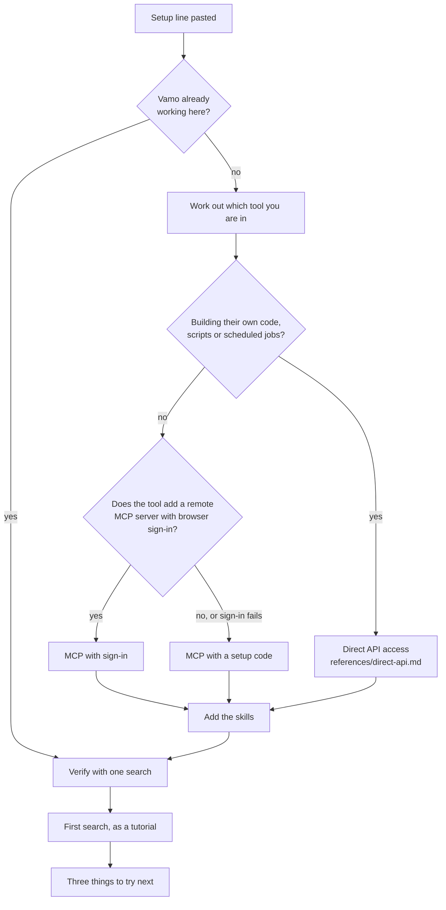

# Get started with Vamo

Vamo finds software engineers by what they have built. Your job is to get this person from
nothing to a first good search, inside the AI tool they already use, set up once so it still works
next week. Teach as you go, at their level.

Most people who paste a setup line are recruiters and founders, not engineers. Plan for that.
Speed up for people who show you they know the terrain.

## Rules

- **Find out by checking, not by asking.** Work out the tool, what it can reach and what is
  already installed by looking. Ask a question only when a check cannot answer it, and then ask
  one question with the answers spelled out.
- **Never ask for an API key, and never accept one pasted into the chat.** Access arrives by
  browser sign-in or by a one-time setup code that starts with `vamo_xc_`. If a key appears in
  the chat anyway, do not use it. Tell the person to revoke it in the Vamo app and get a setup
  code instead.
- **Set it up once, in the right place.** Changing an MCP setup later is the part people get
  stuck on. So check for an existing Vamo setup before adding one, install for the person and not
  for one project, and name the server `vamo` everywhere.
- **One step at a time for a beginner.** Say what the step does in one sentence, give the exact
  thing to click or run, and wait until it is done before the next step.
- **No prices or plan talk about Vamo.** The person's AI tool may have plans that matter. Vamo's
  do not belong here.

## The flow

Work through the steps below in this order.

### 1. Is Vamo already working here?

Look before you add anything.

- Your tool list has Vamo tools in it. Then the MCP server is connected.
- A file `~/.config/vamo/env` exists, or `%USERPROFILE%\.config\vamo\env` on Windows. Then a key
  from an earlier setup is stored on this machine.
- Your available skills include names that start with `vamo`.

If something is there, run the verification in step 6. If it passes, skip to step 7 and tell the
person in one line what you found. Do not set up a second copy.

### 2. Which tool are you?

You usually know which product you are. Say it in one line and carry on. Only when you cannot
tell, ask: "Which app are you talking to me in?" and offer the list from
[`references/tools.md`](references/tools.md).

Note two things about the tool while you are there, because they decide the route:

- **Does it run on the person's own machine** (a terminal or editor agent), or **in a hosted
  chat app** (Claude on the web or desktop, ChatGPT, the Gemini app)?
- **Can your code reach the internet?** If you can run commands, test it:
  `curl -s -m 20 -o /dev/null -w '%{http_code}\n' https://api.vamotalent.ai/openapi.json`.
  `200` means open. Anything else means closed, and that is information, not an error to fix
  yet.

### 3. Pick the route

| Route | Who it is for | How access works |
| --- | --- | --- |
| **MCP with sign-in** (default) | Everyone whose tool adds remote MCP servers with a browser sign-in | The person signs in to Vamo in their browser. No code, no key on the machine |
| **MCP with a setup code** | Tools that cannot sign in through a browser, or when sign-in is not offered or fails | The person copies one line from **Connect a tool** in the Vamo app. The line stores a key privately and adds the server |
| **Direct API** (advanced) | People writing their own code, scripts, scheduled jobs or bulk runs | A key stored privately on their machine or in their platform's secret store. See [`references/direct-api.md`](references/direct-api.md) |

Choose MCP unless the person is building something of their own, with one exception: **in
Claude Code, or another coding agent on the person's own machine, recommend the direct API
setup first.** The skills you install there call the Vamo API directly, so a key stored privately
on the machine is what makes them work in every later session. Adding the MCP server as well is
fine. In a chat app, say it plainly: "I'll connect Vamo as a tool, which is the setup that keeps
working. If you later want to call Vamo from your own code, that is a separate, more technical
setup."

[`references/tools.md`](references/tools.md) gives the default route for each tool and the exact
steps.

The Vamo MCP server is `https://mcp.vamotalent.ai/mcp/search`. When a tool adds it with sign-in,
a browser page opens for the person to sign in to Vamo. If the tool reports that the server needs
a key, or the sign-in page does not appear, switch to the setup code. Do not retry sign-in in a
loop.

### 4. Connect

**MCP with sign-in.** Give the person the steps for their tool from
[`references/tools.md`](references/tools.md). In a terminal tool, run the add command yourself
when you are allowed to. In a hosted chat app the person clicks through settings; tell them
exactly which buttons, and what they will see after each.

**MCP with a setup code.** Ask the person to open the Vamo app, choose **Connect a tool**, pick
this tool and paste the line here. Then fetch the page the line names and follow it exactly. It
stores the key in a private file and adds the server to the tool. The code works once and lasts
ten minutes, so ask for the line when you are ready to use it.

**Direct API.** Follow [`references/direct-api.md`](references/direct-api.md) from **Get access**.

When a step needs someone else (an owner of a Team or Enterprise workspace, an IT admin), do not
stop at "ask your admin". Write the exact message for the person to send, with the one setting
and the one value, and tell them what to do while they wait. The MCP route usually works while
they wait, because connectors do not depend on the sandbox's network.

### 5. Add the skills

The MCP server gives you the tools. The skills teach you to use them well: how to describe the
work instead of a title, how to read results, how to turn a job description into a search. Add
them unless the tool cannot hold skills.

Each tool loads skills differently. [`references/tools.md`](references/tools.md) has the install
for each one. Where none works, read a skill's hosted page when a task needs it:
`https://vamotalent.ai/skills/<skill>.md`, or the same file on GitHub at
`https://raw.githubusercontent.com/vamo-ai/vamo-skills/main/skills/<skill>/SKILL.md`.

Tools load new skills and new MCP servers at the start of a session. When a restart or a new
chat is needed, say so before the person wonders why nothing changed.

### 6. Verify

Run one small search and show one result. On the MCP route, call the Vamo search tool. On the
direct API, run the verification in `references/direct-api.md`.

If it fails, use the `vamo-troubleshooting` skill. Do not switch to a general web or GitHub search
instead: that answers a different question.

### 7. First search, as a tutorial

This is where the person learns how Vamo thinks. Follow
[`references/first-search.md`](references/first-search.md). In short: search for something real
to them, show a few people with the reason each one matched, and attach one short lesson to what
just happened.

### 8. Leave them ready

End with three lines, adapted to the person:

- Three things to ask next, in their own words, for example "Find more people like the second
  one", "What has this person built?", "Run this every Monday and only show me new people".
- How to name a skill in this tool, when they want to (see the tool's row in
  [`references/tools.md`](references/tools.md)). Plain requests work too.
- What to say when something breaks: "Check my Vamo connection."

## Match the person's depth

Read it from what you already have. Do not quiz them.

| You notice | Pitch it as |
| --- | --- |
| A terminal or editor agent, and the person writes about configs, env vars or repositories | **Quick.** Run the steps, report results in one line each, mention where things were written |
| A chat app, plain language, or "I'm not technical" | **Guided.** One step per message. Name the button, say what they will see, wait for "done" |
| The person asks why, or picks the direct API | **Explain.** Add one sentence on how each piece works: what MCP is, where the key lives, why the network setting matters |

If you guessed wrong, they will tell you. Switch without comment.

Words to use with a beginner: "connect Vamo to Claude", "sign in", "the Vamo tools". Words to
avoid until they use them first: MCP, OAuth, bearer, env var, sandbox, scope.

## Staying current

`https://vamotalent.ai/skills/index.json` lists the current version of every skill. Compare it
with `metadata.version` above before setting up a new person or machine.
